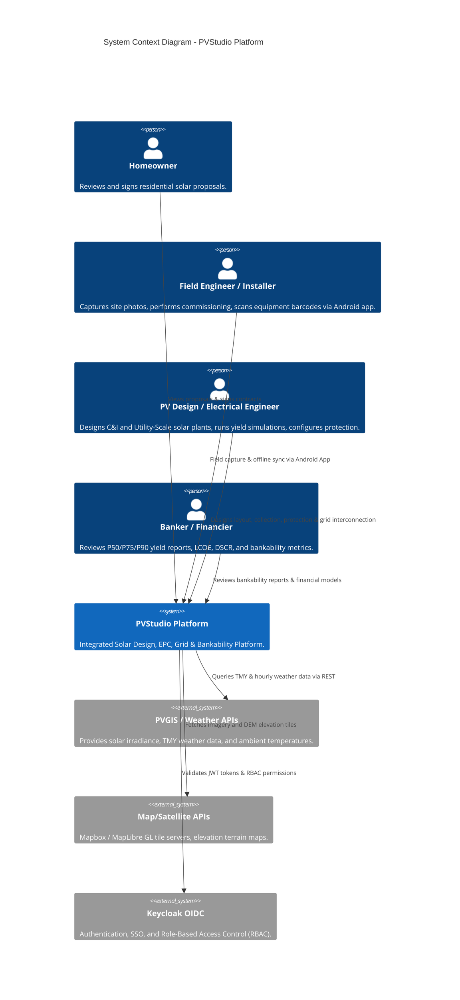
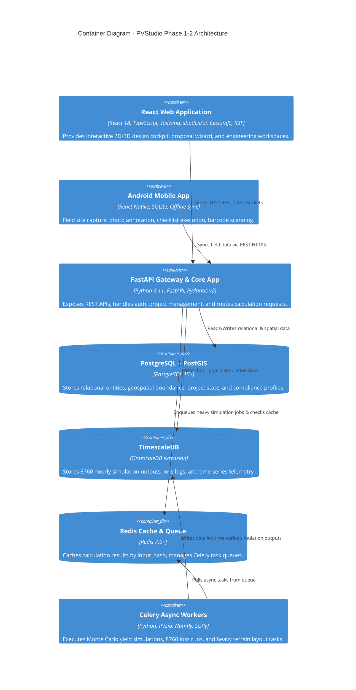

# 01: System Architecture Specification

| Version | Status | Last Updated | Owner |
| :--- | :--- | :--- | :--- |
| 1.0.0 | Approved for Engineering | 2025-02-18 | Principal Software Architect |

---

## 1.1 Overview & Architecture Strategy

PVStudio is designed as a **Modular Monolith** for Phase 1 and Phase 2, enabling high developer velocity, zero network overhead between domain packages, and simplified transactional boundaries. In Phase 3, high-compute and independently scaled domains are extracted into dedicated microservices without requiring architectural refactoring, thanks to strict package boundary isolation enforced from Day 1.

---

## 1.2 System Architecture Diagrams (C4 Model)

### 1.2.1 C4 Level 1: System Context Diagram



---

### 1.2.2 C4 Level 2: Container Diagram (Phase 1–2 Modular Monolith)



---

### 1.2.3 C4 Level 3: Component Diagram (Modular Monolith Internal Architecture)

```mermaid
graph TD
    subgraph FastAPI Core Application
        API[API Router / Controllers]
        AUTH[Auth & RBAC Middleware]
        COMP_ENG[Compliance & Rules Engine]

        subgraph Decoupled Calculation Packages (calc/)
            CY[calc_yield: Physics & Transposition]
            CSD[calc_sizing_dc: Module-Inverter Sizing]
            CED[calc_electrical_dc: Cables, SPDs, Fuses]
            CEA[calc_electrical_ac: Collection & Transformers]
            CP[calc_protection: Relays, Short-Circuit]
            CGL[calc_grounding_lightning: IEC 62305]
            CC[calc_civil: Roads, Grading, Laydown]
            CGI[calc_grid_interconnection: Bay/Voltage Recommender]
            CF[calc_financial: LCOE, NPV, DSCR, Monte Carlo]
            CR[calc_recommender: Architecture Optimizer]
        end
    end

    API --> AUTH
    API --> COMP_ENG
    API --> CY
    API --> CSD
    API --> CED
    API --> CEA
    API --> CP
    API --> CGL
    API --> CC
    API --> CGI
    API --> CF
    API --> CR
```

---

## 1.3 Service Extraction Strategy (Phase 3 Migration)

In Phase 3 (Utility-Scale & Grid Interconnection expansion), the modular monolith will extract four domain microservices to handle long-running, CPU-intensive workloads independently:

| Service Name | Path Scope | Primary Tech Stack | Reason for Extraction |
| :--- | :--- | :--- | :--- |
| **Yield Service** | `/svc/yield` | Python, PVLib, NumPy, SciPy, Numba | High CPU & RAM utilization for 8760 Monte Carlo yield simulations (≥10,000 iterations). |
| **Electrical Service** | `/svc/electrical` | Python, NetworkX, SciPy | Heavy graph traversal for DC string routing, AC cable schedules, and protection coordination. |
| **Grid Service** | `/svc/grid` | Python, PyPSA / Pandapower | Interconnection fault studies, reactive power flow, and MV bay/voltage optimization. |
| **Financial Service** | `/svc/financial` | Python, Pandas, QuantLib | Stochastic project finance modeling, sensitivity matrix generation, and DSCR simulations. |

---

## 1.4 Calculation Traceability & Cross-Cutting Mandates

To ensure bankability and auditability, every single calculated output stored in PostgreSQL or returned via API MUST conform to the strict traceability metadata schema:

```json
{
  "calculation_id": "calc_98a7f21b",
  "calc_module": "calc_electrical_dc",
  "calc_version": "1.4.2",
  "input_hash": "e3b0c44298fc1c149afbf4c8996fb92427ae41e4649b934ca495991b7852b855",
  "profile_id": "US-NEC-2020-v1",
  "timestamp": "2025-02-18T14:32:00Z",
  "execution_time_ms": 142,
  "standards_referenced": ["NEC 2020 Article 690.8", "IEC 60364-5-52 Table B.52.12"],
  "inputs": {
    "v_oc_stc": 49.5,
    "temp_min_c": -10,
    "modules_per_string": 18,
    "temp_coeff_voc": -0.28
  },
  "outputs": {
    "max_system_voltage_v": 978.1,
    "required_cable_mm2": 6.0,
    "voltage_drop_percent": 1.18
  }
}
```

*Rule:* Any result lacking `calc_version`, `input_hash`, or `profile_id` is classified as invalid and cannot be rendered in financial reports or engineering drawings.

---

## 1.5 Async Job Orchestration, Caching & Failure Strategy

Long-running jobs (Monte Carlo 10,000-iteration yield simulations, 8760-hour loss logs, terrain mesh generation) run asynchronously on **Celery/RQ workers**:

* **Hashing & Caching:** All simulation inputs are hashed to generate a deterministic 256-bit `input_hash`. Results are cached in Redis for 30 days and persisted in TimescaleDB. If a request arrives with an identical `input_hash`, cached outputs are returned immediately.
* **Failure & Retry Policy:** Celery tasks use exponential backoff (`max_retries=3`, `retry_backoff=True`). Failed tasks emit a dead-letter queue event and update job status in PostgreSQL to `FAILED` with an explicit error trace.

---

## 1.6 Cloud Infrastructure, Disaster Recovery & Container Deployment Spec

### 1.6.1 Containerization Specifications

* **Base OS Image:** `python:3.11-slim-bookworm` (minimized security attack surface).
* **Process Manager:** `uvicorn` running under `gunicorn` with `uvloop` event loop worker class.
* **Health Check Probes:**
  * Liveness Probe: `GET /health/liveness` (returns 200 OK if process is running).
  * Readiness Probe: `GET /health/readiness` (verifies PostgreSQL, Redis, and Keycloak connectivity).

### 1.6.2 Disaster Recovery (RPO / RTO Budget)

* **Recovery Point Objective (RPO):** $< 5 \text{ minutes}$ (continuous PostgreSQL Write-Ahead Logging WAL shipping to S3).
* **Recovery Time Objective (RTO):** $< 15 \text{ minutes}$ (multi-AZ automated Kubernetes failover via Helm).

---

## 1.7 Security, Authentication & Role-Based Access Control (RBAC)

Authentication is handled via **Keycloak / OpenID Connect (OIDC)** using JWT Bearer tokens. RBAC permissions are strictly enforced at the API route layer using FastAPI dependencies:

| Role Name | Scope & System Permissions |
| :--- | :--- |
| `residential_sales` | Create/edit residential projects, view sales proposals, generate customer PDFs. Blocked from MV/HV electrical settings. |
| `pv_engineer` | Full access to Residential and C&I design tools, 3D layouts, stringing, DC/AC protection, and BOM generation. |
| `lead_utility_engineer` | Full access to Utility-Scale plants, HV substation layout, grid compliance overrides, and Monte Carlo bankability engine. |
| `financial_analyst` | Access to CAPEX/OPEX models, tariff editors, P50/P70/P90 financial sensitivity runs, and bankability reporting. |
| `catalog_admin` | Administrative access to equipment library curation, validation of datasheet specs, and publishing equipment versions. |
