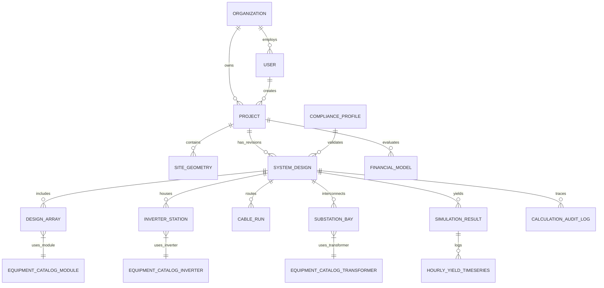

# 02: Data Model & Database Schema Specification

| Version | Status | Last Updated | Owner |
| :--- | :--- | :--- | :--- |
| 1.0.0 | Approved for Engineering | 2025-02-18 | Principal Data Architect |

---

## 2.1 Overview & Database Architecture

PVStudio utilizes a hybrid database architecture optimized for relational domain integrity, geospatial spatial indexing, time-series simulation outputs, and versioned compliance configurations:

1. **PostgreSQL 15+:** Primary transactional store for projects, users, organizations, equipment catalogs, and BOM/BOQ entity graphs.
2. **PostGIS Extension:** Spatial data engine storing roof geometries, property boundaries, array polygon boundaries, cable routing polylines, and terrain Digital Elevation Models (DEM).
3. **TimescaleDB Extension:** Hypertable time-series store for 8760-hour simulation yield outputs, hourly loss logs, and field telemetry.
4. **JSONB Documents:** Versioned rules-as-data compliance profiles and dynamic equipment datasheet parameters.

*Catalog Data Governance Directive:* The equipment catalog sections define ONLY the relational schema, validation rules, and governance workflow. No synthetic or fabricated equipment datasheets are stored or hardcoded in the codebase.

---

## 2.2 Entity Relationship Diagram (ERD)



---

## 2.3 PostgreSQL & PostGIS Schema Definitions

### 2.3.1 Projects & System Design Tables

```sql
-- Projects Table
CREATE TABLE projects (
    id UUID PRIMARY KEY DEFAULT gen_random_uuid(),
    organization_id UUID NOT NULL REFERENCES organizations(id) ON DELETE CASCADE,
    name VARCHAR(255) NOT NULL,
    segment VARCHAR(32) NOT NULL CHECK (segment IN ('RESIDENTIAL', 'COMMERCIAL_INDUSTRIAL', 'UTILITY_SCALE')),
    address TEXT,
    latitude DOUBLE PRECISION NOT NULL,
    longitude DOUBLE PRECISION NOT NULL,
    elevation_m DOUBLE PRECISION,
    jurisdiction_profile_id VARCHAR(64) NOT NULL DEFAULT 'EU-DE-v1',
    created_by UUID NOT NULL REFERENCES users(id),
    created_at TIMESTAMPTZ NOT NULL DEFAULT NOW(),
    updated_at TIMESTAMPTZ NOT NULL DEFAULT NOW()
);

-- Site Geometries (PostGIS)
CREATE TABLE site_geometries (
    id UUID PRIMARY KEY DEFAULT gen_random_uuid(),
    project_id UUID NOT NULL REFERENCES projects(id) ON DELETE CASCADE,
    boundary_polygon GEOMETRY(Polygon, 4326),
    roof_planes GEOMETRY(MultiPolygonZ, 4326),
    keepout_zones GEOMETRY(MultiPolygonZ, 4326),
    terrain_dem_raster RASTER,
    created_at TIMESTAMPTZ NOT NULL DEFAULT NOW()
);

-- System Designs (Versioned Revision Tree)
CREATE TABLE system_designs (
    id UUID PRIMARY KEY DEFAULT gen_random_uuid(),
    project_id UUID NOT NULL REFERENCES projects(id) ON DELETE CASCADE,
    revision_number INT NOT NULL DEFAULT 1,
    name VARCHAR(128) NOT NULL,
    is_active BOOLEAN NOT NULL DEFAULT TRUE,
    architecture_type VARCHAR(32) CHECK (architecture_type IN ('CENTRAL_INVERTER', 'STRING_INVERTER', 'MICRO_INVERTER')),
    dc_capacity_kwp NUMERIC(10, 3) NOT NULL,
    ac_capacity_kwa NUMERIC(10, 3) NOT NULL,
    dc_ac_ratio NUMERIC(4, 3) GENERATED ALWAYS AS (dc_capacity_kwp / NULLIF(ac_capacity_kwa, 0)) STORED,
    compliance_status VARCHAR(32) DEFAULT 'PENDING_REVIEW',
    design_data JSONB NOT NULL, -- Full layout JSON snapshot
    created_at TIMESTAMPTZ NOT NULL DEFAULT NOW(),
    UNIQUE(project_id, revision_number)
);

-- Calculation Audit Log Table (Provenance Guarantee)
CREATE TABLE calculation_audit_log (
    id UUID PRIMARY KEY DEFAULT gen_random_uuid(),
    system_design_id UUID NOT NULL REFERENCES system_designs(id) ON DELETE CASCADE,
    calc_module VARCHAR(64) NOT NULL,
    calc_version VARCHAR(32) NOT NULL,
    input_hash CHAR(64) NOT NULL,
    profile_id VARCHAR(64) NOT NULL,
    execution_time_ms INT NOT NULL,
    standards_referenced TEXT[] NOT NULL,
    input_snapshot JSONB NOT NULL,
    output_snapshot JSONB NOT NULL,
    created_at TIMESTAMPTZ NOT NULL DEFAULT NOW()
);
```

---

### 2.3.2 Equipment Catalog Tables & Governance

Equipment datasheets are version-controlled, admin-validated, and immutable once referenced by an active design.

```sql
-- PV Module Catalog Table
CREATE TABLE catalog_pv_modules (
    id UUID PRIMARY KEY DEFAULT gen_random_uuid(),
    manufacturer VARCHAR(128) NOT NULL,
    model_name VARCHAR(128) NOT NULL,
    p_mp_w NUMERIC(6, 2) NOT NULL, -- Nominal Power at STC
    v_mp_v NUMERIC(6, 2) NOT NULL,
    i_mp_a NUMERIC(6, 2) NOT NULL,
    v_oc_v NUMERIC(6, 2) NOT NULL,
    i_sc_a NUMERIC(6, 2) NOT NULL,
    temp_coeff_pmp_percent_per_c NUMERIC(5, 3) NOT NULL,
    temp_coeff_voc_percent_per_c NUMERIC(5, 3) NOT NULL,
    bifaciality_factor NUMERIC(3, 2) DEFAULT 0.0,
    technology VARCHAR(32) CHECK (technology IN ('TOPCon', 'HJT', 'PERC', 'FirstSolar_CdTe')),
    length_mm INT NOT NULL,
    width_mm INT NOT NULL,
    weight_kg NUMERIC(5, 2) NOT NULL,
    is_validated BOOLEAN NOT NULL DEFAULT FALSE,
    version INT NOT NULL DEFAULT 1,
    created_at TIMESTAMPTZ NOT NULL DEFAULT NOW(),
    UNIQUE(manufacturer, model_name, version)
);

-- Inverter Catalog Table
CREATE TABLE catalog_inverters (
    id UUID PRIMARY KEY DEFAULT gen_random_uuid(),
    manufacturer VARCHAR(128) NOT NULL,
    model_name VARCHAR(128) NOT NULL,
    inverter_type VARCHAR(32) CHECK (inverter_type IN ('MICRO', 'STRING_LV', 'CENTRAL_MV')),
    p_ac_kw NUMERIC(8, 2) NOT NULL,
    v_ac_nominal_v NUMERIC(6, 1) NOT NULL,
    mppt_count INT NOT NULL DEFAULT 1,
    inputs_per_mppt INT NOT NULL DEFAULT 1,
    v_mppt_min_v NUMERIC(6, 1) NOT NULL,
    v_mppt_max_v NUMERIC(6, 1) NOT NULL,
    v_dc_max_v NUMERIC(6, 1) NOT NULL,
    i_dc_max_per_mppt_a NUMERIC(6, 1) NOT NULL,
    euro_efficiency_percent NUMERIC(4, 2) NOT NULL,
    is_validated BOOLEAN NOT NULL DEFAULT FALSE,
    version INT NOT NULL DEFAULT 1,
    created_at TIMESTAMPTZ NOT NULL DEFAULT NOW(),
    UNIQUE(manufacturer, model_name, version)
);
```

---

### 2.3.3 TimescaleDB Yield Hypertable Schema

```sql
-- TimescaleDB Hypertable for Hourly Simulation Outputs
CREATE TABLE simulation_hourly_yield (
    simulation_id UUID NOT NULL,
    timestamp TIMESTAMPTZ NOT NULL,
    poa_irradiance_wm2 NUMERIC(7, 2),
    cell_temperature_c NUMERIC(5, 2),
    dc_power_kw NUMERIC(10, 2),
    ac_power_kw NUMERIC(10, 2),
    clipping_loss_kw NUMERIC(10, 2),
    soiling_loss_kw NUMERIC(10, 2),
    grid_curtailment_kw NUMERIC(10, 2),
    net_grid_export_kwh NUMERIC(10, 2)
);

-- Convert to Hypertable partitioned by time
SELECT create_hypertable('simulation_hourly_yield', 'timestamp');
CREATE INDEX idx_sim_id_time ON simulation_hourly_yield (simulation_id, timestamp DESC);
```

---

## 2.4 Indexing & Partitioning Strategy

1. **Spatial PostGIS Indexing:** GIST index on `site_geometries(boundary_polygon)` and `site_geometries(roof_planes)`.
2. **Project Lookups:** B-tree composite index on `projects(organization_id, segment, created_at DESC)`.
3. **TimescaleDB Compression:** Enable TimescaleDB compression policies for `simulation_hourly_yield` data older than 7 days, reducing storage footprint by ~90%.
