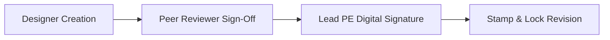

# 05: UI/UX Specification & Design System

| Version | Status | Last Updated | Owner |
| :--- | :--- | :--- | :--- |
| 1.0.0 | Approved for Engineering | 2025-02-18 | Lead UI/UX Architect |

---

## 5.1 Design System & Typography

PVStudio utilizes an "Engineering Cockpit" UI design philosophy. It balances dense technical telemetry with clear visual hierarchy, satisfying both high-speed sales workflows and deep utility-scale engineering.

* **Design Tokens:** Defined in a single `theme.tokens.json`.
* **Typography:** `Inter` for primary UI text, `JetBrains Mono` for engineering formulas, coordinates, and calculation outputs.
* **Accessibility:** WCAG 2.1 AA compliant contrast ratios across all light and dark mode color palettes.
* **i18n & Localization:** English is default. UI layout, grid containers, and component trees are built on RTL-ready flex/grid primitives to support right-to-left languages (e.g., Arabic, Persian) in future releases without layout refactoring.

---

## 5.2 Color Tokens & Semantic Color Rules

```json
{
  "color": {
    "background": {
      "dark": "#0B0F17",
      "light": "#F8FAFC"
    },
    "surface": {
      "dark": "#1E293B",
      "light": "#FFFFFF"
    },
    "semantic": {
      "solar_irradiance": "#F59E0B",
      "dc_current": "#EF4444",
      "ac_current": "#3B82F6",
      "grounding": "#10B981",
      "warning": "#F97316",
      "error": "#DC2626"
    }
  }
}
```

---

## 5.3 Report Booklet Customization & Generation

The reporting engine produces customizable PDF and editable DOCX report booklets:

* **Section-Level Toggling:** Engineers can toggle individual sections on or off (e.g., include/exclude civil foundations or Monte Carlo sensitivity histograms).
* **Corporate White-Labeling:** Custom logo placement, primary/accent brand colors, cover page background images, and custom header/footer disclaimers.
* **Template Selection:** Pre-configured report templates for Residential Homeowner Proposal, C&I Permit Package, Utility-Scale Bankability Booklet, and Interconnection Study Brief.
* **Mandatory Data Stamp:** Every generated report MUST print the weather dataset metadata (name, vintage range, resolution, override status) and trace hash (`calc_module`, `calc_version`, `input_hash`, `profile_id`, `timestamp`).

---

## 5.4 Calculation Transparency Side-Panel

Every calculated number rendered in the UI (e.g., maximum string voltage $V_{oc,max} = 978.1 \text{ V}$, DC cable size $6.0 \text{ mm}^2$, or LCOE $\$36.10/\text{MWh}$) is clickable. Clicking the metric opens a side-drawer displaying:

1. **Exact Mathematical Formula:** Rendered via KaTeX.
2. **Input Values & Provenance:** Source data used (e.g., weather dataset vintage, ambient min temp).
3. **Standards Citation:** Active rule (e.g., *NEC 2020 Article 690.7* or *IEC 62548 §7.2*).
4. **Sensitivity Slider:** Interactive widget allowing the engineer to adjust key variables (e.g., temperature coefficient or cable length) and observe real-time recalculation impact.

---

## 5.5 Digital Signature & Approval Workflow UI

To support institutional financing and engineering sign-offs, the UI provides a multi-tier approval widget:



* **Roles:** `Designer` -> `Reviewer` -> `Approver (PE)`.
* **Digital Signature:** Cryptographic signature stamp applied to final bankable PDF reports.

---

## 5.6 Mobile Android Performance Budget & Offline Experience

* **Performance Budget:** Max APK size = $45 \text{ MB}$, initial launch time $< 1.5 \text{ s}$, 60 FPS checklist scrolling.
* **Offline First:** SQLite local database storing assigned site visit checklists, cable schedules, and inspection forms.
* **Camera Annotation:** Photo capture with inline vector drawing (arrows, callouts, text notes).
* **Barcode Scanning:** High-speed camera barcode/QR scanner capturing equipment serial numbers and associating them with specific string layout nodes.
* **Lightweight Scope:** Mobile app strictly excludes 3D simulation rendering, consuming pre-rendered design outputs and syncing field observations back to the cloud.
