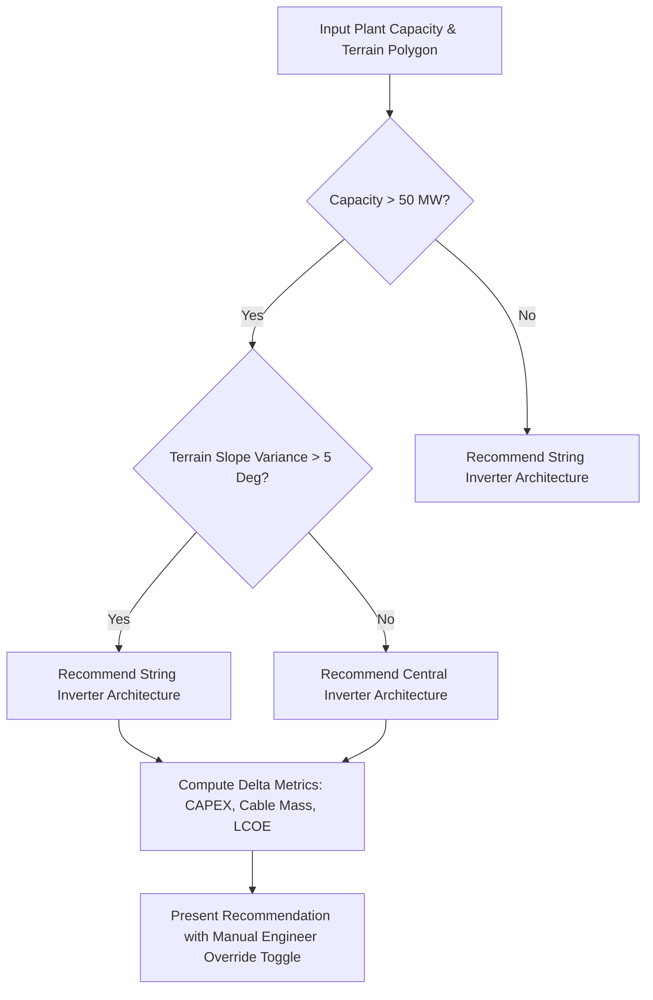

# 07: Segment-Specific Workflows & Auto-Recommenders Specification

| Version | Status | Last Updated | Owner |
| :--- | :--- | :--- | :--- |
| 1.0.0 | Approved for Engineering | 2025-02-18 | Lead Product Architect |

---

## 7.1 Overview & Segment Isolation Strategy

PVStudio dynamically tailors its menu structures, UI components, equipment libraries, and calculation engines based on the project market segment selected during project creation:

1. **Residential Segment (< 10 kW):** High-velocity sales wizard, roof-plane geometry constraint, micro-inverter / string sizing, homeowner proposals.
2. **Commercial & Industrial Segment (C&I, < 1 MW):** Permit-ready engineering, 3D roof/ground layout, string routing, LV/MV collection, protection coordination, and RFQ procurement.
3. **Utility-Scale Segment (> 1 MW):** Terrain-following plant layout, central vs. string inverter auto-recommender, MV collection bay/voltage auto-sizing, HV substation, IEC 62305 earthing, P50/P75/P90 Monte Carlo bankability.

---

## 7.2 Segment Divergent Workflows & Menu Trees

```mermaid
graph TD
    START[Project Onboarding] --> SEG_SEL{Select Segment}

    SEG_SEL -->|Residential| R_TREE
    SEG_SEL -->|C&I| C_TREE
    SEG_SEL -->|Utility-Scale| U_TREE

    subgraph R_TREE[Residential Workflow Tree]
        R1[1. Site Capture] --> R2[2. Roof Layout & Obstacles]
        R2 --> R3[3. Module & Inverter Sizing]
        R3 --> R4[4. Proposal & Cash Savings]
        R4 --> R5[5. Permitting PDF Package]
    end

    subgraph C_TREE[C&I Workflow Tree]
        C1[1. Site & Geospatial] --> C2[2. 3D Roof/Ground Layout]
        C2 --> C3[3. String/Inverter Sizing]
        C3 --> C4[4. AC Collection & Protection]
        C4 --> C5[5. Interconnection Analysis]
        C5 --> C6[6. Procurement & RFQ]
        C6 --> C7[7. C&I Financial Model]
    end

    subgraph U_TREE[Utility-Scale Workflow Tree]
        U1[1. Land Screening & Terrain] --> U2[2. Architecture Auto-Recommender]
        U2 --> U3[3. Array Layout & Block Design]
        U3 --> U4[4. MV Collection & Bay Auto-Sizing]
        U4 --> U5[5. HV Substation & Protection]
        U5 --> U6[6. IEC 62305 Earthing & Lightning]
        U6 --> U7[7. P50/P75/P90 Bankability Engine]
    end
```

---

## 7.3 Residential Segment Specification

* **Primary Objective:** Deliver a signed proposal and permit package in $< 30$ minutes.
* **Equipment Focus:** Single-phase string inverters (0.8 kV LV), micro-inverters, residential AC/DC coupled battery storage, rooftop flush-mount racking.
* **Layout Paradigm:** Roof-plane constrained polygon drawing, automatic obstacle exclusion (chimneys, HVAC units, skylights), rapid shade ratio calculation.
* **Battery Storage Structural Scope:** Battery storage in Residential is part of the **Core Sizing Path** (sized for energy autonomy, self-consumption optimization, or backup power).
* **Electrical Scope:** String length matching, DC/AC cable sizing, main panel connection checks (120% rule per NEC 705.12). No upstream transformer or substation design.

---

## 7.4 C&I Segment Specification

* **Primary Objective:** Produce permit-ready SLD, three-line diagrams, verified BOM/BOQ, and RFQ packages.
* **Equipment Focus:** Three-phase string inverters (LV output), LV/MV pad-mounted transformers, C&I battery energy storage systems (BESS), MV switchgear at PCC.
* **Layout Paradigm:** Hybrid roof/ground arrays, row spacing optimization to prevent inter-row shading, equipment pad placement, cable tray routing.
* **Electrical Scope:** Complete AC collection schedule, protection coordination (LV breakers, fuses, SPDs), fault current calculation, and interconnection relay settings.

---

## 7.5 Utility-Scale Segment Specification

* **Primary Objective:** Bankable pre-construction engineering, CAPEX/OPEX optimization, grid-code compliance, and P50/P75/P90 Monte Carlo yield reports.
* **Equipment Focus:** Central inverter stations (containerized ~33 kV) vs. decentralized string inverters, MV collection switchgear, HV step-up transformers (e.g., 33 kV / 110 kV or 220 kV), SCADA/RTU, reclosers, numerical protection relays, and IEC 62305 earthing networks.
* **Battery Storage Structural Scope (Mandatory Distinction):** Battery storage in Utility-Scale is NOT required by default. It exists solely as an **Optional Grid-Services Module** (sized for peak shaving, ramp-rate control, or frequency response) and is structurally separate from off-grid battery sizing.

---

## 7.6 Central vs. String Inverter Decision Tree Diagram

### Technical Decision Matrix

| Constraint / Metric | Central Inverter Architecture | String Inverter Architecture |
| :--- | :--- | :--- |
| **Plant Capacity** | Optimal for large, contiguous plants ($> 50 \text{ MW}$). | Optimal for small-to-mid plants ($1 - 50 \text{ MW}$) or segmented blocks. |
| **Terrain Slope** | Requires flat or gently sloping terrain ($< 3^\circ$). | Handles steep or irregular terrain ($> 5^\circ$) with granular MPPTs. |
| **DC Cable Length** | Long DC homeruns to central inverter pads. | Short DC homeruns, long AC collection cables. |
| **O&M Replacement** | Requires specialized MV technicians on site. | Rapid field swap of lightweight string inverter units. |

---

## 7.7 MV Collection Bay Count & Voltage Level Auto-Sizing Rules

For Utility-Scale plants, the system automatically computes the required MV collection voltage and substation feeder bay count:

1. **Voltage Level Determination:**
   * $P_{plant} \le 20 \text{ MW} \implies \mathbf{11 \text{ kV or } 22 \text{ kV}}$.
   * $20 \text{ MW} < P_{plant} \le 100 \text{ MW} \implies \mathbf{33 \text{ kV or } 34.5 \text{ kV}}$.
   * $P_{plant} > 100 \text{ MW} \implies \mathbf{66 \text{ kV Collection or Direct HV Step-Up}}$.

2. **Feeder Bay Count Formula:**
   $$N_{feeder\_bays} = \left\lceil \frac{P_{plant,kW}}{\sqrt{3} \cdot V_{MV,kV} \cdot I_{bay\_max\_ampacity,A} \cdot \cos \phi} \right\rceil + 1 \text{ (Spare Bay)}$$

3. **Real-Time Recalculation:**
   If the engineer overrides the recommended voltage level or bay count, the system dynamically updates the cable schedule, transformer tap ratings, switchgear cost line items, and estimated LCOE in real-time.
