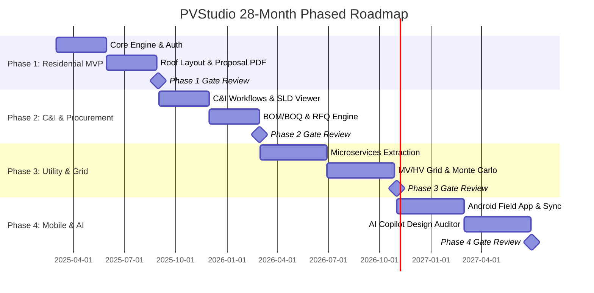

# 09: Phased Delivery Plan & Acceptance Gates

| Version | Status | Last Updated | Owner |
| :--- | :--- | :--- | :--- |
| 1.0.0 | Approved for Engineering | 2025-02-18 | Program Director & Lead Architect |

---

## 9.1 Phased Delivery Roadmap Overview

PVStudio follows a disciplined, value-producing 28-month phased roadmap. Monolithic architecture debt is prevented by enforcing modular decoupling in early phases before microservices extraction in Phase 3.

---

## 9.2 Phase Breakdown & Hard Acceptance Gates

### Phase 1 — Foundation & Residential MVP (Months 0–6)
* **Scope:** Authentication (Keycloak OIDC), project management, site capture, roof layout with shading, residential on-grid/hybrid sizing, string inverter library, basic financial model, PDF proposal generation, core calculation engine (`calc_yield`, `calc_sizing_dc`, `calc_electrical_dc`).
* **Hard Acceptance Gate:**
  1. A residential sales user can go from address entry to a signed-ready proposal and verified BOM in $< 30$ minutes.
  2. The calculation engine passes 10 reference benchmark cases against PVsyst/SAM with $\le 1.5\%$ variance.

---

### Phase 2 — C&I Expansion & Procurement (Months 6–12)
* **Scope:** C&I workflow, three-phase string inverters, LV/MV pad-mounted transformers, AC collection design (`calc_electrical_ac`), protection coordination (`calc_protection`), full BOM/BOQ, RFQ generation, and procurement tracking.
* **Hard Acceptance Gate:**
  1. A C&I project up to 1 MW can produce a permit-ready SLD, complete BOM, and financial model.
  2. Procurement module generates and tracks an RFQ through supplier submission.

---

### Phase 3 — Utility-Scale & Grid Interconnection (Months 12–20)
* **Scope:** Microservices extraction (`/svc/yield`, `/svc/electrical`, `/svc/grid`, `/svc/financial`), Central vs. String inverter auto-recommender, MV collection bay/voltage auto-sizing (`calc_grid_interconnection`), HV substation layout, IEC 62305 earthing (`calc_grounding_lightning`), and 10,000-iteration Monte Carlo P50/P75/P90 yield engine.
* **Hard Acceptance Gate:**
  1. A utility-scale plant ($> 1 \text{ MW}$) can be designed end-to-end with automated bay count and voltage level recommendation.
  2. The bankability engine produces an exportable financier report containing all engineering, financial, and grid-compliance sections.

---

### Phase 4 — Mobile Field Operations, AI Copilot & Ecosystem (Months 20–28)
* **Scope:** Full Android app for installation and commissioning (offline checklists, camera photo annotation, barcode scanning), AI-assisted design review (error detection, optimization suggestions with cited standards), API ecosystem for CRM/ERP/BIM integration.
* **Hard Acceptance Gate:**
  1. Field data captured on Android syncs without data loss or table overwrites to cloud designs.
  2. AI Copilot flags $\ge 80\%$ of intentionally introduced design errors in a test suite while citing the relevant standard clause for each flag.
