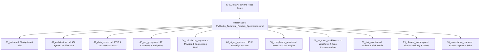

# Master Technical Product Specification: PVStudio Solar Platform

```
Version: 1.0.0
Status: FINAL — Approved [2025-02-18]
Change Control: Frozen. Any change requires a v1.1 change request.
```

| Version | Status | Last Updated | Owner |
| :--- | :--- | :--- | :--- |
| 1.0.0 | FINAL — Approved | 2025-02-18 | Principal Software Architect & Lead PV Engineer |

---

## Executive Summary & Product Mandate

**PVStudio** is an integrated, multi-segment solar PV design, engineering, procurement, grid-interconnection, and bankability platform. It delivers end-to-end design capabilities for three distinct market segments:

1. **Residential (< 10 kW per rooftop):** Design-around-the-sale, rapid automated roof layout, shading analysis, micro-inverter/string sizing, homeowner proposals, and permitting packages.
2. **Commercial & Industrial (C&I, < 1 MW per site):** Permit-ready engineering, 3D roof/ground layout, string routing, LV/MV AC collection design, protection coordination, interconnection studies, complete BOM/BOQ, RFQ generation, and cash flow financial modeling.
3. **Utility-Scale (> 1 MW per plant):** Terrain-following array layout, central vs. string inverter auto-recommender, MV collection network design with automated bay and voltage level proposals, HV substation design, SCADA/RTU architecture, IEC 62305 earthing/lightning design, bankable P50/P75/P90 Monte Carlo yield modeling, and project finance DSCR models.

---

## Document Architecture & Navigation Map

This specification is organized into a master document and 10 detailed sub-specifications. Each sub-specification is independently versioned, fully cross-referenced, and contains exact mathematical formulas, standard citations, schemas, or architectural diagrams.



### Sub-Specification Index

* [§1.0 System Architecture](01_architecture.md): Modular Monolith (FastAPI) transitioning to microservices (Phase 3), Celery workers, Keycloak OIDC, PostgreSQL/PostGIS, TimescaleDB, and React Web + React Native Mobile stack.
* [§2.0 Data Model](02_data_model.md): PostgreSQL ERD, JSONB compliance profiles, versioned equipment catalogs, PostGIS geospatial tables, and TimescaleDB 8760 time-series structures.
* [§3.0 API Groups](03_api_groups.md): REST API endpoint definitions for Projects, Layout, Calculations, Equipment Catalogs, Financial Models, Compliance Engine, and Mobile Offline Sync.
* [§4.0 Calculation Engine](04_calculation_engine.md): 10 calculation micro-packages (`calc_yield`, `calc_sizing_dc`, `calc_electrical_dc`, `calc_electrical_ac`, `calc_protection`, `calc_grounding_lightning`, `calc_civil`, `calc_grid_interconnection`, `calc_financial`, `calc_recommender`), Monte Carlo P50/P75/P90 engine, and Python Pydantic I/O contracts.
* [§5.0 UI/UX Specification](05_ui_ux_spec.md): Engineering cockpit UI, light/dark WCAG 2.1 AA theme, calculation transparency side-panels, step-by-step Wizard vs Expert mode, CesiumJS/R3F viewports, and Android field offline UX.
* [§6.0 Compliance Matrix](06_compliance_matrix.md): Rules-as-data model, YAML compliance profiles (EU-DE, US NEC 2020/2023, AU-NZ, MENA-GCC), standards matrix (IEC 62548, 60364, 62305, 61724-1, 61727, IEEE 1547, NEC), and refusal-to-guess safeguards.
* [§7.0 Segment Workflows](07_segment_workflows.md): Divergent workflows, equipment defaults, central vs. string inverter architecture decision engine, and MV collection bay count / voltage level auto-sizing rules.
* [§8.0 Risk Register](08_risk_register.md): Technical, regulatory, computational, and operational risk assessment with mitigation strategies and ownership.
* [§9.0 Phased Roadmap](09_phased_roadmap.md): Months 0–28 roadmap (Phase 1: Residential MVP, Phase 2: C&I Expansion, Phase 3: Utility-Scale & Grid, Phase 4: Mobile Operations & AI Copilot) with hard acceptance gates.
* [§10.0 Acceptance Tests](10_acceptance_tests.md): Given/When/Then BDD test suite covering physics calculations, grid compliance enforcement, segment auto-recommenders, and offline mobile data synchronization.

---

## Key Platform Architectural Directives

1. **Deterministic & Transparent Math:** Every calculated metric must expose its input values, formula, assumptions, calculation version, and cited standard in a clickable transparency side-panel. No black-box calculations are permitted.
2. **Rules-as-Data Engine:** Jurisdictional grid codes and electrical rules are maintained in external, versioned YAML profiles (`compliance/profiles/*.yaml`). Hardcoded regulatory logic in core code is strictly prohibited.
3. **Refusal-to-Guess Safeguard:** If a regulatory profile or site parameter is missing or incomplete, the system must refuse auto-approval and emit an explicit warning requiring qualified human engineer sign-off.
4. **Traceability Guarantee:** Every generated report, BOM, and simulation output carries an immutable hash (`calc_module`, `calc_version`, `input_hash`, `profile_id`, `timestamp`).
5. **Mobile Field Strategy:** The Android mobile app operates offline-first for site capture, checklist execution, photo annotation, and barcode scanning, delegating complex 3D rendering and physics simulations to cloud API workers.
